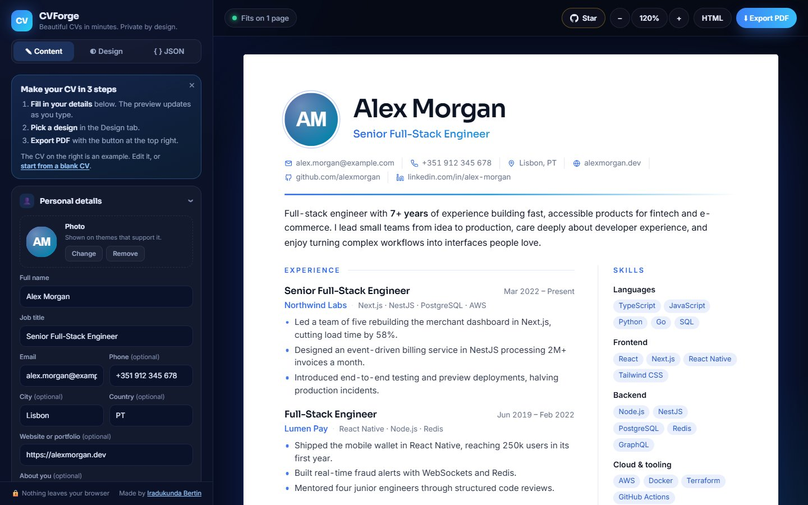
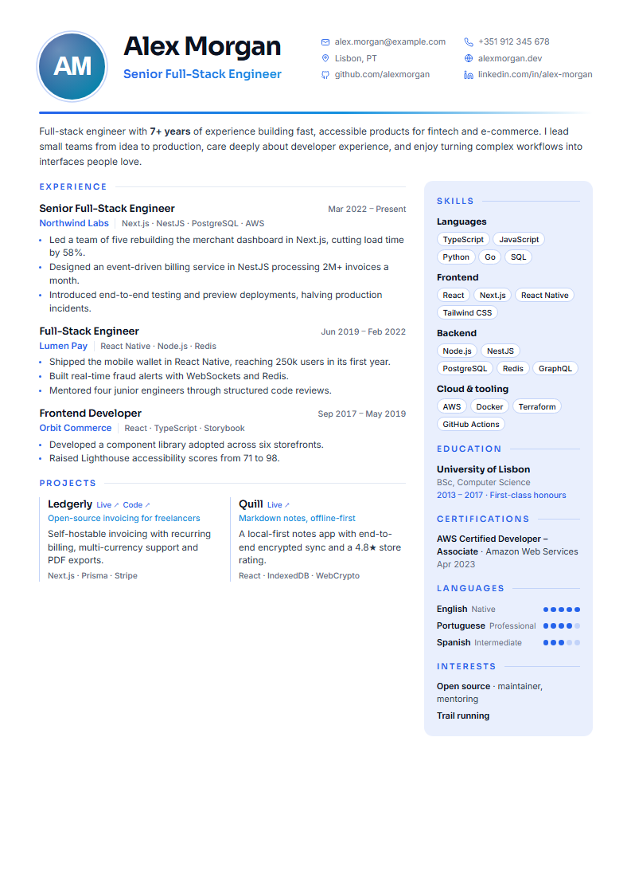
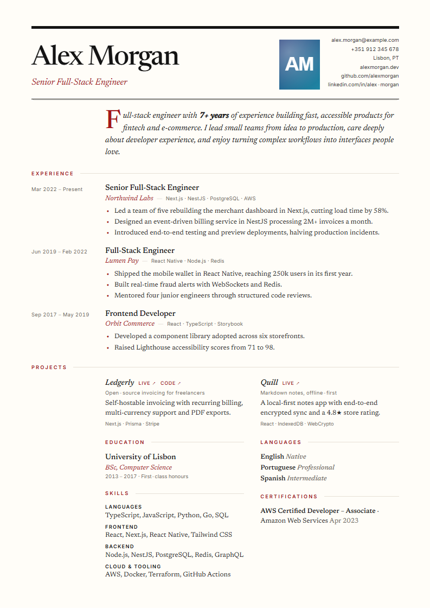
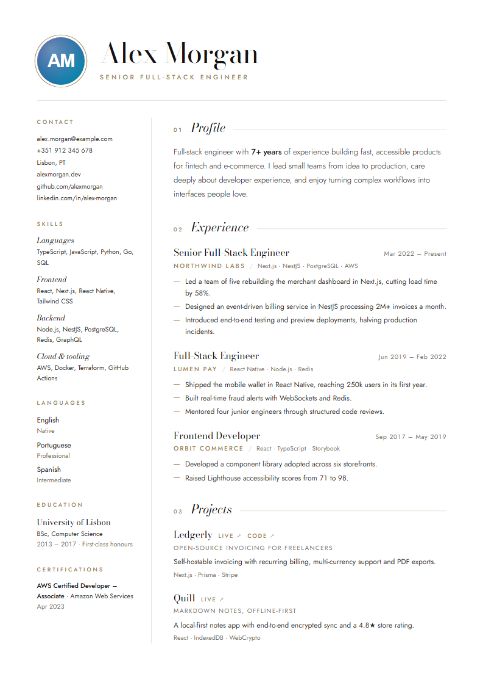
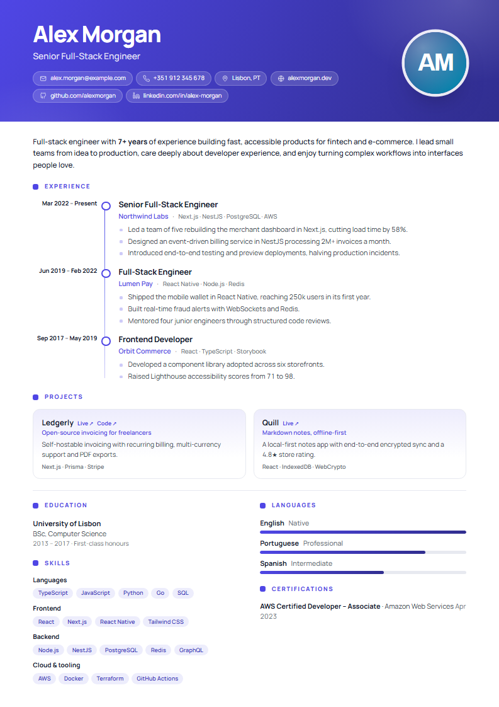
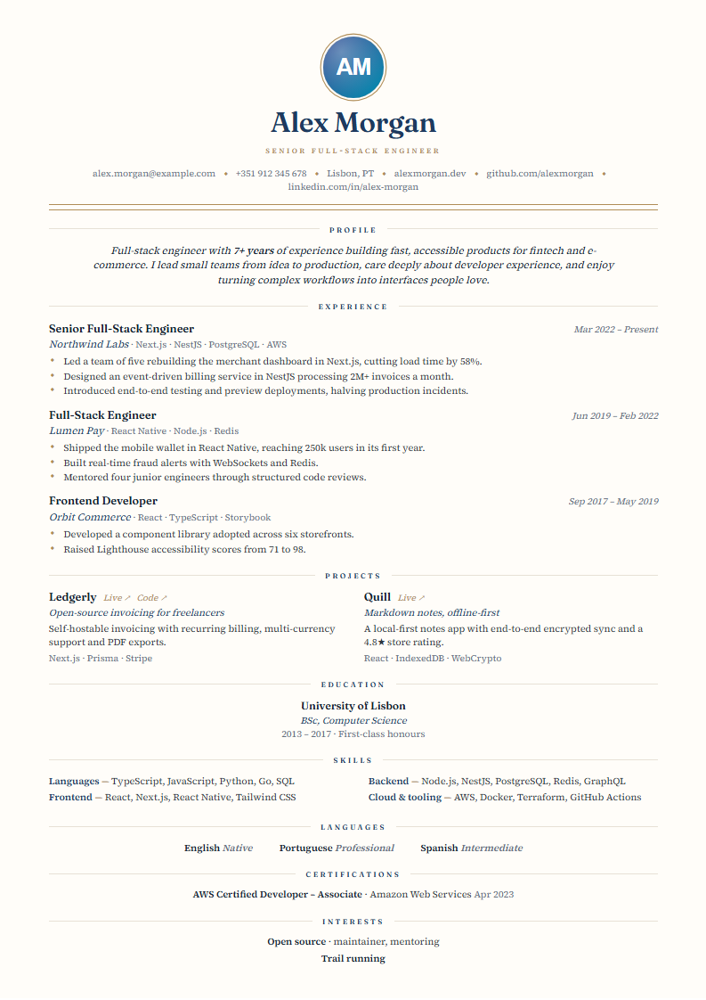
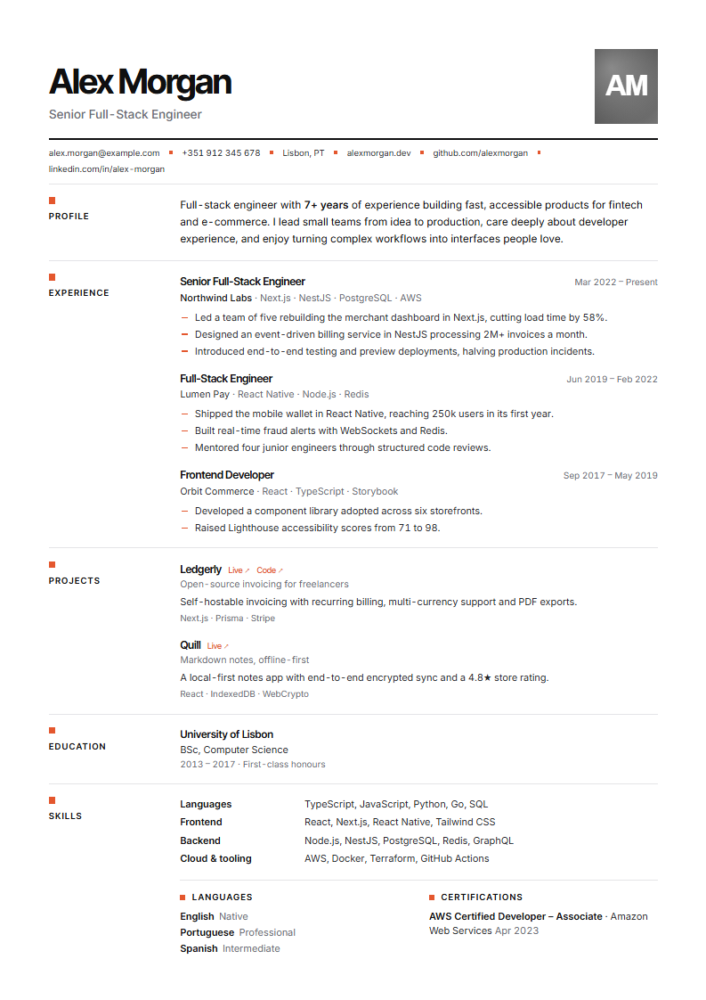
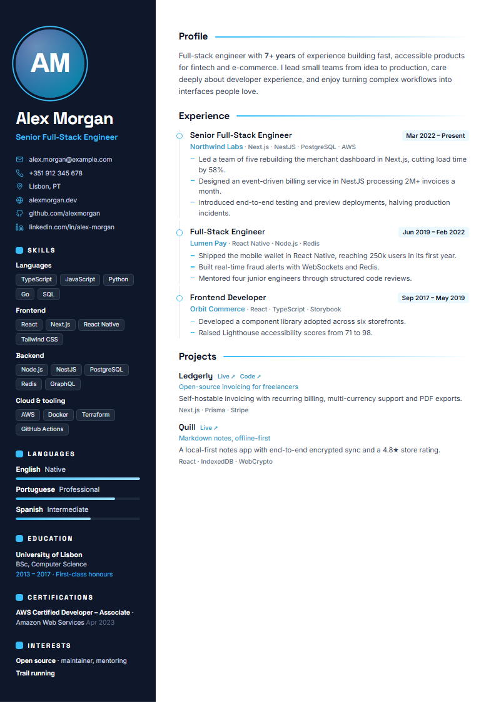
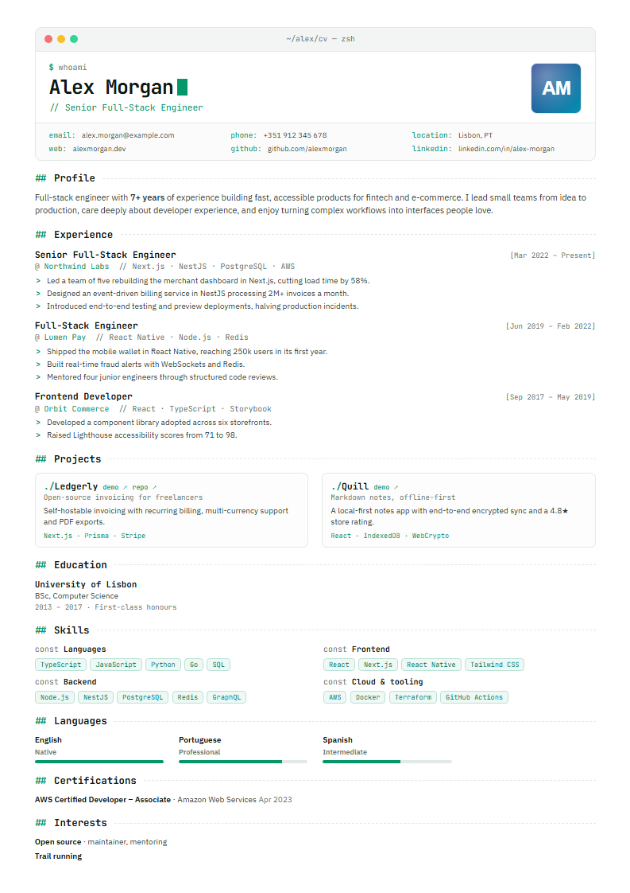

<div align="center">

# CVForge

**Write your CV as data. Get a beautiful, ATS-friendly PDF.**

### [Open the web app → cvdesign.vercel.app](https://cvdesign.vercel.app)

Eight premium themes · JSON Resume compatible · auto-fit to one page · live studio · web app · zero dependencies

[](https://github.com/bertini01/cv-builder/actions/workflows/test.yml)
[](https://www.npmjs.com/package/cvforge)


If CVForge saves you time, please ⭐ [star the repo](https://github.com/bertini01/cv-builder): it helps others find it.



</div>

---

Keep your career in one JSON file, then render it in any theme, any accent colour, A4 or US Letter, as PDF, HTML or PNG. Change a line, rebuild, done. No design tools, no copy-pasting between templates, no subscriptions, and your data stays on your machine.

## Three ways to use it

| | |
| --- | --- |
| **[Web app](https://cvdesign.vercel.app)** | Fill in a simple form (no JSON needed), pick a design and export a PDF. Nothing is uploaded; everything runs in your browser. |
| **CLI** | `npx cvforge build resume.json`: one command to a pixel-perfect PDF, ideal for scripts and CI. |
| **Studio** | `npx cvforge studio resume.json`: a local live editor that reloads whenever you save your resume. |

## Themes

Every theme takes any accent colour, A4 or Letter, and auto-fits to your page limit.

<table>
<tr>
<td align="center" width="25%"><br><b>Aurora</b><br><sub>Modern two-column, hairline gradient</sub></td>
<td align="center" width="25%"><br><b>Editorial</b><br><sub>Magazine spread, drop-cap lede</sub></td>
<td align="center" width="25%"><br><b>Atelier</b><br><sub>Fashion-house luxury, Bodoni</sub></td>
<td align="center" width="25%"><br><b>Horizon</b><br><sub>Colour band and timeline</sub></td>
</tr>
<tr>
<td align="center"><br><b>Executive</b><br><sub>Quiet luxury, ivory and gold</sub></td>
<td align="center"><br><b>Minimal</b><br><sub>Swiss, most ATS-friendly</sub></td>
<td align="center"><br><b>Noir</b><br><sub>Deep-ink sidebar</sub></td>
<td align="center"><br><b>Terminal</b><br><sub>Developer flavour</sub></td>
</tr>
</table>

## Features

- **Premium design system**: 10 pt body type, generous margins, two typefaces per theme, restrained colour and right-aligned dates, following current guidance on readable, recruiter-friendly CVs.
- **Auto-fit**: give it a page limit and it gently tightens spacing and type until the CV fits, then verifies the real PDF page count.
- **ATS-friendly output**: real, selectable text in a logical reading order, plus a tagged, outlined PDF.
- **[JSON Resume](https://jsonresume.org/schema) compatible**: bring an existing `resume.json`, or write the resume as a JS module.
- **Flexible**: section order, hidden sections, renamed titles, built-in French, German, Spanish and Portuguese headings, locale-aware dates, optional photo and lightweight Markdown (`**bold**`, `*italic*`, `` `code` ``, `[links](https://…)`).
- **Multi-page done right**: page margins repeat on every printed page, and entries never split awkwardly across pages.
- **Safe**: all text is escaped, and links are limited to `https`, `mailto` and `tel`, so a shared resume file can't inject scripts.
- **Zero dependencies**: Node's standard library plus the Chrome, Edge, Chromium or Brave already on your machine.

## Quick start

Requires **Node.js 22+** and a Chromium-based browser for the CLI and studio. The web app only needs a browser.

```bash
npx cvforge init                       # creates resume.json (and a sample avatar)
npx cvforge studio resume.json         # live editor at http://localhost:4321
npx cvforge build resume.json --theme editorial --accent "#7c3aed"
```

Prefer a global install? `npm install -g cvforge`, then use `cvforge …`.

## Commands

| Command | What it does |
| --- | --- |
| `cvforge build [resume.json]` | Build the CV (PDF by default). `cvforge resume.json` works too. |
| `cvforge studio [resume.json]` | Open the studio at `http://localhost:4321` with live reload. |
| `cvforge themes` | List the themes. |
| `cvforge init [resume.json]` | Create a starter resume. |
| `cvforge validate [resume.json]` | Check a resume and explain any problems. |

### Options

| Flag | Default | Description |
| --- | --- | --- |
| `-t, --theme <id>` | `aurora` | `aurora`, `editorial`, `atelier`, `horizon`, `executive`, `minimal`, `noir`, `terminal` |
| `-a, --accent <hex>` | theme's own | Accent colour, e.g. `"#e11d48"` |
| `-p, --paper <size>` | `a4` | `a4` or `letter` |
| `--max-pages <n>` | `1` | Page limit to auto-fit to (`0` = no limit) |
| `--no-fit` | | Don't adjust spacing to respect the limit |
| `--density <n>` | `1` | Starting spacing and type scale, `0.7` to `1.3` |
| `--no-photo` | | Leave out `basics.image` |
| `--sections <list>` | theme order | Sections to show, in order, e.g. `summary,work,skills` |
| `--hide <list>` | | Sections to leave out |
| `--locale <code>` | `en` | Dates and headings, e.g. `fr`, `de`, `es`, `pt` |
| `--date-format <f>` | `short` | `short` (May 2024), `long`, `numeric` (05/2024) or `year` |
| `-f, --format <list>` | `pdf` | Any of `pdf,html,png` |
| `-o, --out <dir>` | `dist` | Output folder |
| `-n, --name <pattern>` | `{name} CV` | File name; supports `{name}` and `{theme}` |
| `-c, --config <file>` | `cv.config.json` | Options file |
| `--port <n>` | `4321` | Studio port (the next free one is used if taken) |
| `--no-open` | | Don't open the browser when the studio starts |

Section ids: `summary`, `work`, `projects`, `education`, `skills`, `languages`, `certificates`, `awards`, `volunteer`, `publications`, `interests`, `references`.

## Config file

Settings can live in `cv.config.json` next to your resume. The studio's **Save settings** button writes it for you, and CLI flags override it.

```json
{
  "theme": "atelier",
  "accent": "#7c3aed",
  "paper": "letter",
  "maxPages": 1,
  "sections": ["summary", "work", "projects", "skills", "education", "languages"],
  "labels": { "work": "Career" },
  "locale": "fr",
  "output": { "dir": "dist", "name": "{name} CV {theme}", "formats": ["pdf", "png"] }
}
```

Setting `locale` to `fr`, `de`, `es` or `pt` translates titles and "Present" automatically; your own `labels` always win.

## Resume format

CVForge reads the [JSON Resume schema](https://jsonresume.org/schema), so an existing `resume.json` should work as is. A few optional extensions make developer CVs better:

| Field | Shown as |
| --- | --- |
| `work[].keywords` | The tech stack next to the company |
| `projects[].tagline` | A one-line subtitle under the project name |
| `projects[].source` | A "Code" link next to the "Live" link |

Dates can be `YYYY`, `YYYY-MM` or `YYYY-MM-DD`; a missing `endDate` reads as "Present". `basics.image` can be a URL or a path relative to the resume (`png`, `jpg`, `webp`, `svg`); local images are embedded so the HTML output is self-contained. See [`examples/resume.json`](examples/resume.json).

## Web app

Try it at **[cvdesign.vercel.app](https://cvdesign.vercel.app)**. Fill in the form, or switch to the JSON tab to paste an existing JSON Resume; both stay in sync and are saved in your browser.

The web app is a static site built from the same theme engine (`npm run web` builds it into `site/`). It renders and auto-fits in the browser and exports PDFs through the browser's own print engine. It ships with a strict Content Security Policy and stores your resume only in your browser's local storage.

Host your own copy in one click:

[](https://vercel.com/new/clone?repository-url=https%3A%2F%2Fgithub.com%2Fbertini01%2Fcv-builder)

## How auto-fit works

Every theme sizes its type and spacing from one CSS variable, `--d` (density). When the CV is over the page limit, CVForge binary-searches the largest density between `0.78` and your starting density at which it fits. The exact same function runs in the CLI (through headless Chrome), the studio and the web app, so the preview always matches the export. After printing, the CLI counts the PDF's real pages and nudges further if print rounding tipped it over.

## Programmatic API

```js
import { build, mergeOptions } from "cvforge";

const options = mergeOptions({ theme: "terminal", output: { formats: ["pdf", "png"] } });
const { files, pages, density } = await build("resume.json", options);
```

Also exported: `renderDocument` (resume to HTML string), `loadResume`, `validateResume`, `normalizeResume`, `THEMES`, `fitDocument` and more. See [`src/index.mjs`](src/index.mjs). The rendering modules are browser-safe and can be imported directly from `src/render.mjs`, `src/normalize.mjs` and `src/options.mjs`.

## Writing a theme

A theme is a module in `src/themes/` exporting an object:

```js
export default {
   id: "mytheme",
   name: "My Theme",
   description: "One line for the studio and `cvforge themes`.",
   accent: "#2563eb",
   fonts: "family=Inter:wght@400;600",       // Google Fonts query (optional)
   side: ["skills", "languages"],            // optional sidebar sections
   render: (ctx) => `<main class="page">…</main>`,
   css: (ctx) => `…`,
};
```

`ctx` holds the normalised `resume`, the merged `labels`, the `main` and `side` section ids in order, and `photo`. Helpers in [`src/themes/shared.mjs`](src/themes/shared.mjs) render contact lists and every section with stable class names, and `splitSections` builds a compact details grid, so a theme is mostly CSS. Use `s(9, "pt")` for sizes so they scale with density. Register the theme in `src/themes/index.mjs`, then run `npm run previews` and `npm test`.

## FAQ

**Why does the CLI need a browser?** Chrome's print engine produces excellent, searchable PDFs, and using the one you already have keeps CVForge dependency-free. Set `CHROME_PATH` if yours is somewhere unusual.

**Does it work offline?** Yes. Themes use Google Fonts when online and fall back to system fonts otherwise.

**Is my data sent anywhere?** No. The CLI and studio run locally (the studio only listens on `127.0.0.1` and rejects cross-site requests), and the web app keeps everything in your browser.

## Development

```bash
npm test            # unit tests + real PDF builds (skipped without a browser)
npm run studio      # studio with the example resume
npm run web         # build the web app into site/
npm run previews    # regenerate the theme gallery
```

## License

[MIT](LICENSE) © [Iradukunda Bertin](https://bertin.vercel.app)
