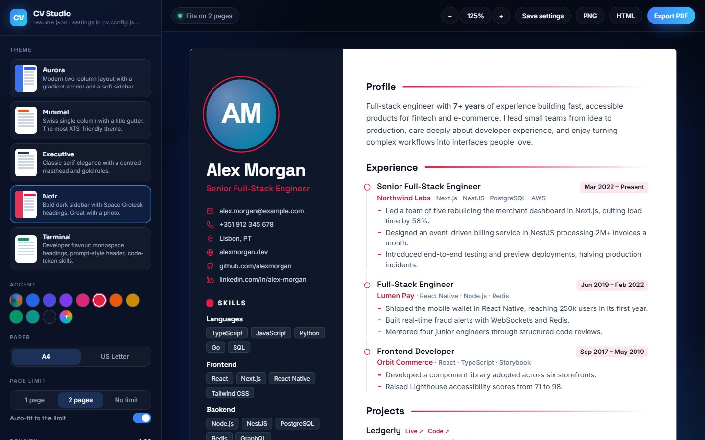

<div align="center">

# CV Builder

**Write your CV as data. Get a beautiful, ATS-friendly PDF.**

Five premium themes · JSON Resume compatible · auto-fit to one page · live studio · zero dependencies

[](https://github.com/bertini01/cv-builder/actions/workflows/test.yml)




</div>

---

Keep your career in one JSON file, then render it in any theme, any accent colour, A4 or US Letter, as PDF, HTML or PNG. Change a line, rebuild, done. No design tools, no copy-pasting between templates, no subscriptions, and nothing leaves your machine.

## Features

- **Five premium themes**: modern, Swiss, classic serif, dark sidebar and developer, each tuned for print.
- **Auto-fit**: give it a page limit and it gently tightens spacing and type until the CV fits, then verifies the real PDF page count.
- **CV Studio**: a local live editor with theme switching, accent colours, paper size, density, drag-to-reorder sections and one-click export. It reloads whenever you save your resume.
- **[JSON Resume](https://jsonresume.org/schema) compatible**: bring an existing `resume.json`, or write the resume as a JS module.
- **ATS-friendly output**: real, selectable text in a logical reading order, plus a tagged, outlined PDF.
- **Flexible**: section order, hidden sections, renamed or translated titles, locale-aware dates, optional photo, and lightweight Markdown (`**bold**`, `*italic*`, `` `code` ``, `[links](https://…)`).
- **Robust**: clear validation messages with exact paths, JSON errors with line and column, and safe HTML escaping throughout.
- **Zero dependencies**: Node's standard library plus the Chrome, Edge, Chromium or Brave already on your machine.

## Themes

<table>
<tr>
<td align="center"><br><b>Aurora</b><br><sub>Modern two-column, gradient accent</sub></td>
<td align="center"><br><b>Minimal</b><br><sub>Swiss single column, most ATS-friendly</sub></td>
<td align="center"><br><b>Executive</b><br><sub>Classic serif, centred, gold rules</sub></td>
</tr>
<tr>
<td align="center"><br><b>Noir</b><br><sub>Bold dark sidebar, great with a photo</sub></td>
<td align="center"><br><b>Terminal</b><br><sub>Developer flavour, code-token skills</sub></td>
<td align="center">Every theme takes<br>any accent colour,<br>A4 or Letter,<br>and auto-fits.</td>
</tr>
</table>

## Quick start

Requires **Node.js 22+** and a Chromium-based browser (Chrome, Edge, Chromium or Brave).

```bash
# Install the CLI from GitHub
npm install -g github:bertini01/cv-builder

# Create a starter resume, then open the studio
cv-builder init
cv-builder studio resume.json

# Or build straight to PDF
cv-builder build resume.json --theme executive --accent "#7c3aed"
```

Prefer not to install globally? Clone the repo and run `node bin/cv-builder.mjs` instead of `cv-builder`.

## Commands

| Command | What it does |
| --- | --- |
| `cv-builder build [resume.json]` | Build the CV (PDF by default). `cv-builder resume.json` works too. |
| `cv-builder studio [resume.json]` | Open CV Studio at `http://localhost:4321` with live reload. |
| `cv-builder themes` | List the themes. |
| `cv-builder init [resume.json]` | Create a starter resume (and a sample avatar). |
| `cv-builder validate [resume.json]` | Check a resume and explain any problems. |

### Options

| Flag | Default | Description |
| --- | --- | --- |
| `-t, --theme <id>` | `aurora` | `aurora`, `minimal`, `executive`, `noir`, `terminal` |
| `-a, --accent <hex>` | theme's own | Accent colour, e.g. `"#e11d48"` |
| `-p, --paper <size>` | `a4` | `a4` or `letter` |
| `--max-pages <n>` | `1` | Page limit to auto-fit to (`0` = no limit) |
| `--no-fit` | | Don't adjust spacing to respect the limit |
| `--density <n>` | `1` | Starting spacing and type scale, `0.7` to `1.3` |
| `--no-photo` | | Leave out `basics.image` |
| `--sections <list>` | theme order | Sections to show, in order, e.g. `summary,work,skills` |
| `--hide <list>` | | Sections to leave out |
| `--locale <code>` | `en` | Date locale, e.g. `fr`, `de`, `pt-BR` |
| `--date-format <f>` | `short` | `short` (May 2024), `long`, `numeric` (05/2024) or `year` |
| `-f, --format <list>` | `pdf` | Any of `pdf,html,png` |
| `-o, --out <dir>` | `dist` | Output folder |
| `-n, --name <pattern>` | `{name} CV` | File name; supports `{name}` and `{theme}` |
| `-c, --config <file>` | `cv.config.json` | Options file |
| `--port <n>` | `4321` | Studio port (the next free one is used if taken) |
| `--no-open` | | Don't open the browser when the studio starts |

Section ids: `summary`, `work`, `projects`, `education`, `skills`, `languages`, `certificates`, `awards`, `volunteer`, `publications`, `interests`, `references`.

## Config file

Settings can live in `cv.config.json` next to your resume. The studio's **Save settings** button writes it for you, and CLI flags override it.

```json
{
  "theme": "noir",
  "accent": "#e11d48",
  "paper": "letter",
  "maxPages": 1,
  "photo": true,
  "sections": ["summary", "work", "projects", "skills", "education", "languages"],
  "labels": { "work": "Expérience", "present": "Aujourd'hui" },
  "locale": "fr",
  "dateFormat": "short",
  "output": { "dir": "dist", "name": "{name} CV {theme}", "formats": ["pdf", "png"] }
}
```

`labels` renames any section title (and the word used for ongoing roles). Setting `locale` to `fr`, `de`, `es` or `pt` translates titles and "Present" automatically; your own `labels` always win.

## Resume format

CV Builder reads the [JSON Resume schema](https://jsonresume.org/schema), so an existing `resume.json` should work as is. A few optional extensions make developer CVs better:

| Field | Shown as |
| --- | --- |
| `work[].keywords` | The tech stack next to the company |
| `projects[].tagline` | A one-line subtitle under the project name |
| `projects[].source` | A "Code" link next to the "Live" link |

Dates can be `YYYY`, `YYYY-MM` or `YYYY-MM-DD`; a missing `endDate` reads as "Present". `basics.image` can be a URL or a path relative to the resume (`png`, `jpg`, `webp`, `svg`); local images are embedded so the HTML output is self-contained. Summaries and highlights accept `**bold**`, `*italic*`, `` `code` `` and `[links](https://…)`.

Resumes can also be JavaScript modules (`resume.mjs` exporting the object as `default`), which is handy for comments or computed values.

See [`examples/resume.json`](examples/resume.json) for a complete example.

## How auto-fit works

Every theme sizes its type and spacing from one CSS variable, `--d` (density). When the CV is over the page limit, CV Builder binary-searches the largest density between `0.78` and your starting density at which it fits, inside the page itself. The studio preview runs the exact same script, so what you see is what you get. After printing, the build counts the PDF's real pages and nudges further if print rounding tipped it over.

If it can't fit even at the minimum, you get a clear message to trim content rather than an unreadable CV.

## Programmatic API

```js
import { build, mergeOptions } from "cv-builder";

const options = mergeOptions({ theme: "terminal", output: { formats: ["pdf", "png"] } });
const { files, pages, density } = await build("resume.json", options);
```

Also exported: `renderDocument` (resume to HTML string), `loadResume`, `validateResume`, `normalizeResume`, `THEMES`, `fitScript` and more. See [`src/index.mjs`](src/index.mjs).

## Writing a theme

A theme is a module in `src/themes/` exporting an object:

```js
export default {
   id: "mytheme",
   name: "My Theme",
   description: "One line for the studio and `cv-builder themes`.",
   accent: "#2563eb",                       // default accent
   fonts: "family=Inter:wght@400;600",       // Google Fonts query (optional)
   side: ["skills", "languages"],            // optional sidebar sections
   render: (ctx) => `<main class="page">…</main>`,
   css: (ctx) => `…`,
};
```

`ctx` holds the normalised `resume`, the merged `labels`, the `main` and `side` section ids in order, and `photo`. Helpers in [`src/themes/shared.mjs`](src/themes/shared.mjs) render contact lists and every section with stable class names, so a theme is mostly CSS. Use `s(9, "pt")` for sizes so they scale with density. Register the theme in `src/themes/index.mjs`.

## FAQ

**Why is a browser required?** Chrome's print engine produces excellent, searchable PDFs. Using the browser you already have keeps CV Builder dependency-free. Set `CHROME_PATH` if yours is somewhere unusual.

**Does it work offline?** Yes. Themes use Google Fonts when online and fall back to system fonts otherwise.

**Is my data sent anywhere?** No. Everything runs locally; the studio only listens on `127.0.0.1` and rejects cross-site requests.

## Development

```bash
npm test            # unit tests + real PDF builds (skipped without a browser)
npm run studio      # studio with the example resume
npm run previews    # regenerate the README theme gallery
```

## License

[MIT](LICENSE) © [Iradukunda Bertin](https://bertin.vercel.app)
